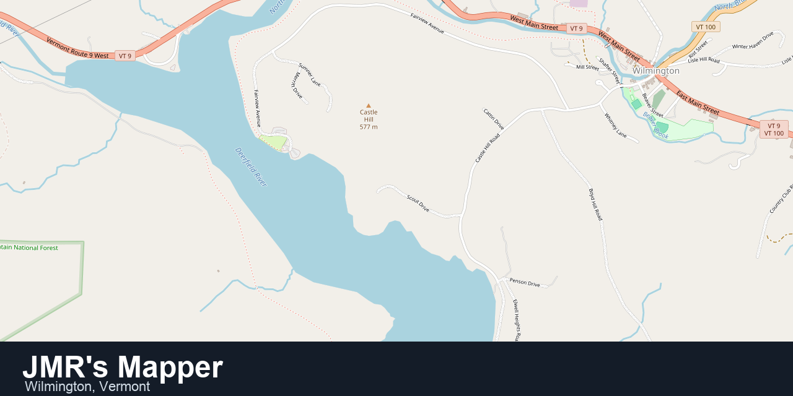

# JMR's Mapper



A simple browser map for GPX tracks. The map opens on the Wilmington, Vermont area and does **not** load any tracks until you add a GPX file.

## Open it

On iPhone or any browser: [https://jmrothberg.github.io/jmrs-mapper/](https://jmrothberg.github.io/jmrs-mapper/)

From this folder:

```bash
python3 -m http.server 8765
```

Then open [http://127.0.0.1:8765/](http://127.0.0.1:8765/). You can also open `index.html` directly.

## How to use it

- **Add GPX files** — load one or more recordings. Each file is a group in the list
- **On / off** — uncheck a file, a track, or a segment to hide it
- **Regular map / Satellite** — basemap buttons
- **Color** (default) — click a line to select it and change its color
- **Split** — choose Split on the toolbar, then click the start and the end of the piece you want. That cuts the segment into the part before, the part between, and the part after. You can tap the dots or the line. After the cut, the tool returns to Color. Choose Split again for another cut
- **Name** — type a name in the list
- **Delete** — click **×**
- **Show names on map** — puts each segment’s name next to the line
- **Line style** — Normal, Thin, Dashed, or Thin dashed on any segment
- **Save map** — downloads one GPX with every segment, color, name, line style, and map view. Opening that file later restores it. It also remembers the map in this browser
- **Fit visible** — zoom to whatever is currently turned on
- A GPX outside the default Wilmington area moves the map to that track

Works on iPhone and iPad: the tools sit in a bottom panel you can collapse with ▾. Add this page to the Home Screen for a full-screen app.

After you split a track, a track checkbox appears so you can hide that whole track or just one piece.

## Files

- `index.html` — the map app
- `vermont-track-2.1.gpx` — short OsmAnd recording (3 tracks)
- `2026-08-07_14-45_Fri.gpx` — longer OsmAnd recording
